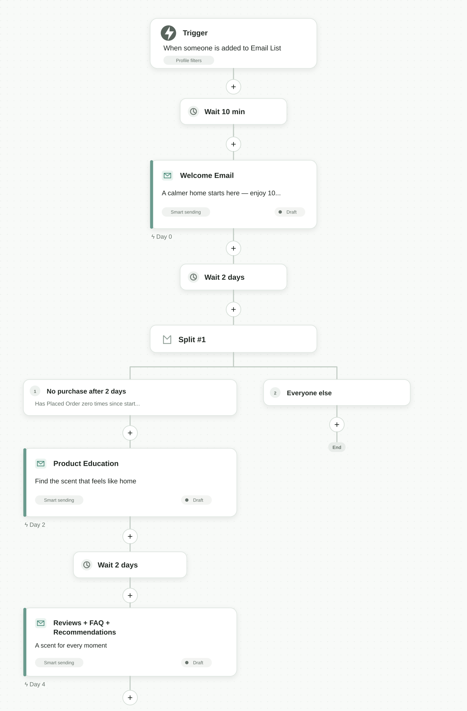
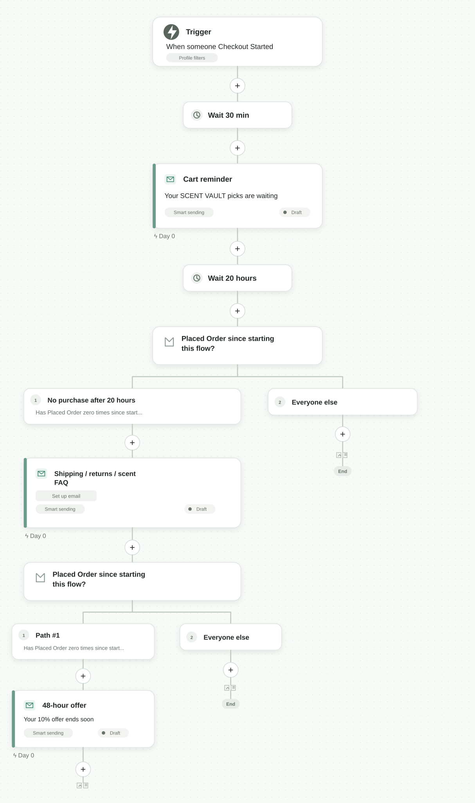
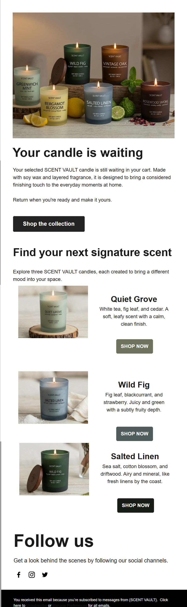
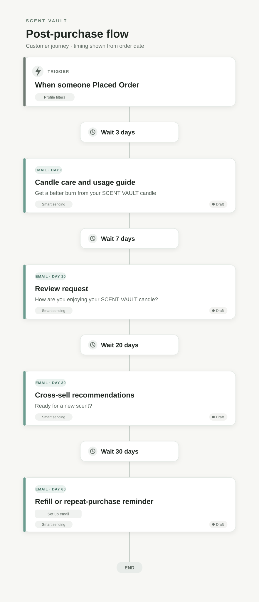
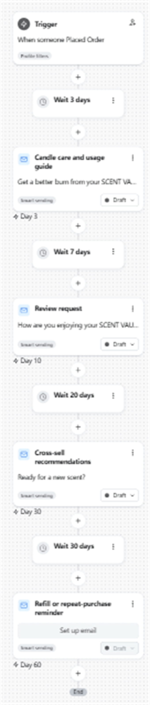
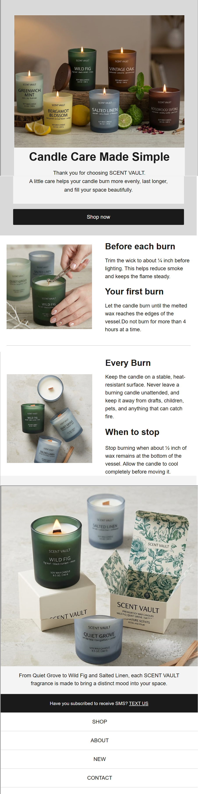
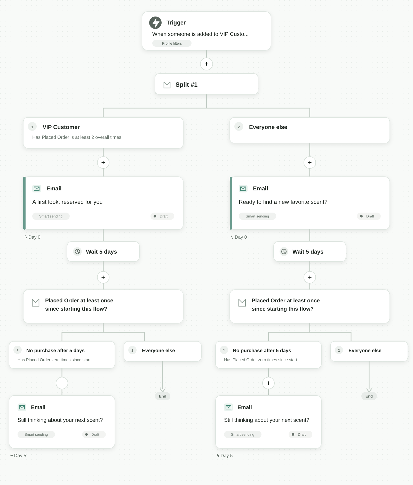

# SCENT VAULT｜Klaviyo 用户生命周期营销自动化模拟项目

> **作品集案例 · 模拟项目**  ↩
> SCENT VAULT 是为展示 CRM 策略、Klaviyo Flow 设计、邮件内容和效果衡量而创建的虚拟跨境 DTC 家居香氛品牌。项目中的产品、图片、分层阈值和效果目标均为模拟内容。

## 一、项目概览

| 项目     | 内容                                          |
| ------ | ------------------------------------------- |
| 品牌     | SCENT VAULT，虚拟美国 DTC 家居香氛品牌                 |
| 店铺     | 与 Klaviyo 连接的 Shopify 开发测试店                 |
| 产品线    | Quiet Grove、Wild Fig、Salted Linen 等香氛蜡烛概念产品 |
| 展示岗位能力 | CRM / 用户生命周期运营 / EDM 自动化                    |
| 使用工具   | Shopify、Klaviyo、邮件编辑器、用户分层工具                |
| 业务问题   | 如何把匿名访客和一次性购买用户，转化为可识别、可复购的用户               |
| 项目产出   | 4 条自动化 Flow、邮件创意、用户分层逻辑、测试方案和指标框架           |

## 二、项目目标

本项目将用户生命周期阶段转化为可执行的邮件自动化：

```text
Shopify 用户行为
→ 用户身份与营销许可
→ 生命周期分层
→ 个性化 Flow
→ 邮件内容与 CTA
→ 购买/互动行为
→ 抑制触达或进入下一步策略
```

项目遵循三个原则：

1. **根据行为触达，而不是只按日历群发。** 例如，弃购提醒由 `Checkout Started` 触发，购后指导由 `Placed Order` 触发。
2. **用户完成目标动作后及时停止或改变沟通。** 已购买用户退出拉新和弃购流程，避免继续发送不相关内容。
3. **同时衡量互动和商业价值。** 综合关注点击、订单、每位收件人收入、复购、退订和投诉率。

## 三、用户分层与数据逻辑

### 核心 List

`Newsletter - US`

Shopify 前台订阅邮件的用户同步到该 Klaviyo List，并作为 Welcome Flow 的入口。

### Segments

| Segment             | 筛选逻辑                                                           | 运营动作                       |
| ------------------- | -------------------------------------------------------------- | -------------------------- |
| `VIP Customers`     | 历史累计至少完成 2 次 `Placed Order`。如果后续同步了经过验证的 LTV 用户属性，可以再加入消费金额门槛。 | 新品优先体验、专属内容和服务型留存，避免无差别发券。 |
| `At Risk - 60 Days` | 历史至少有 1 次 `Placed Order`，且最近 60 天没有 `Placed Order`，并且允许接收营销邮件。 | 基于购买历史和用户价值进行召回。           |
| `Sunset Hold`       | 最近 90 天至少收到 5 封邮件，且 0 次点击邮件、0 次下单。                             | 将长期无响应用户从促销触达中排除。          |

## 四、Flow 设计

### 4.1 Welcome Flow｜新订阅欢迎流程

**触发器**：`Added to List → Newsletter - US`  
**过滤条件**：允许接收营销邮件；进入本 Flow 后尚未下单；可选增加 30 天内不重复进入限制。

| 时间     | 节点        | 目的                   |
| ------:| --------- | -------------------- |
| 0 分钟   | 触发器       | 识别刚刚订阅的访客。           |
| +10 分钟 | 邮件 1：欢迎邮件 | 介绍品牌并提供首单激励。         |
| +2 天   | 条件分支      | 判断用户进入 Flow 后是否已经下单。 |
| —      | YES → 结束  | 已购买用户不再接收拉新内容。       |
| —      | NO → 邮件 2 | 介绍香味类型、使用场景和选购方法。    |
| +2 天   | 邮件 3      | 通过评价、FAQ 和推荐降低购买顾虑。  |

**邮件 1 内容方向**

```text
主题：A calmer home starts here — enjoy 10% off
预览文案：Thoughtful scents for everyday rituals.
按钮：Explore the collection
```



### 4.2 Abandoned Checkout Flow｜弃购挽回流程

**触发器**：`Checkout Started`  
**过滤条件**：进入 Flow 后没有 `Placed Order`；允许接收营销邮件；在支持该条件的账户中增加重复进入限制。

| 时间     | 节点         | 目的                  |
| ------:| ---------- | ------------------- |
| +30 分钟 | 邮件 1：购物车提醒 | 温和提醒用户继续完成购买。       |
| +20 小时 | 条件分支       | 如果已经下单，则停止后续邮件。     |
| —      | NO → 邮件 2  | 解答配送、退换货和香味选择问题。    |
| +24 小时 | 条件分支       | 再次判断是否已经购买。         |
| —      | NO → 邮件 3  | 提供明确有效期的优惠，不虚构库存紧张。 |





### 4.3 Post-purchase Flow｜购后运营流程

**触发器**：`Placed Order`  
**边界说明**：订单确认、付款确认和物流通知属于 Shopify 交易邮件，仍应由交易系统发送。Klaviyo 在这里承担购后教育、评价收集、关联推荐和复购提醒。

| 时间    | 节点        | 目的                       |
| -----:| --------- | ------------------------ |
| +3 天  | 蜡烛使用与养护指南 | 帮助用户正确使用产品，减少因使用不当产生的不满。 |
| +10 天 | 评价邀请      | 在用户有一定使用体验后收集反馈。         |
| +30 天 | 关联商品推荐    | 推荐互补香味或相关产品，而不是无差别重复推荐。  |
| +60 天 | 补充装/复购提醒  | 在可能的补购或送礼节点前重新触达。        |







### 4.4 Win-back Flow｜沉默用户召回流程

**触发器**：`Person enters a segment → At Risk - 60 Days`  
**过滤条件**：允许接收营销邮件；不属于 `Sunset Hold`。

| 分支           | 内容策略                         |
| ------------ | ---------------------------- |
| VIP 分支       | 新品预览、优先购买或服务型权益，不一开始就使用普通折扣。 |
| 普通用户分支       | 个性化产品推荐和模拟 10% 复购优惠。         |
| 5 天后仍未购买     | 发送一次最后提醒，然后停止流程。             |
| 最后阶段仍无点击、无购买 | 进入 `Sunset Hold` 的抑制触达逻辑。    |



## 五、邮件内容体系

邮件设计保持统一的 SCENT VAULT 视觉和内容规则：

- 暖色中性背景和深灰色文字；
- 以产品图片作为主要信息证明；
- 每个模块设置清晰的 CTA；
- 使用适合移动端阅读的短段落；
- 页脚包含退订和邮件偏好管理链接；
- 不使用无法证明的“无毒”“零化学成分”或保证疗效等表述。

### 生命周期内容地图

| 生命周期阶段 | 用户主要问题             | 内容回应              | 主要 KPI          |
| ------ | ------------------ | ----------------- | --------------- |
| 欢迎     | “这个品牌是什么，为什么值得了解？” | 品牌介绍、香味探索、首单激励    | 点击率、首购转化率       |
| 弃购     | “香味选错怎么办，配送是否方便？”  | 商品提醒、FAQ、配送/退换货说明 | 弃购挽回率、每位收件人收入   |
| 购后     | “怎样才能正确使用产品？”      | 蜡烛养护、安全和使用指导      | 点击率、评价率、客服问题减少量 |
| 召回     | “我为什么现在要回来购买？”     | 相关新品、补购提醒或 VIP 权益 | 复购率、每位收件人收入     |

## 六、指标与实验方案

### Flow 层级 KPI

- 邮件送达率和退信率；
- 点击率 CTR；
- 下单转化率；
- 每位收件人收入 RPR；
- 弃购挽回率；
- 购后评价提交率；
- 召回流程复购率；
- 退订率和垃圾邮件投诉率；
- 被 `Sunset Hold` 抑制触达的用户占比。

### A/B Test 示例

在 Welcome 邮件 1 中只测试主题文案，不同时改变正文和优惠：

| 版本  | 主题                                         |
| --- | ------------------------------------------ |
| A   | Welcome to SCENT VAULT — enjoy 10% off     |
| B   | A calmer home starts here — 10% off inside |

**主要判断指标**：7 天内下单转化率和每位已送达收件人的收入。  
**辅助指标**：CTR、退订率和投诉率。  
**控制变量**：正文、优惠、CTA 和发送时间保持一致，确保主要测试的是主题文案。


